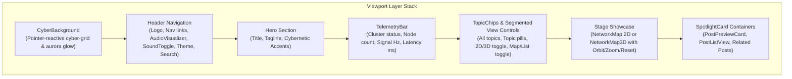

# Cybernetic Immersion & Animation Enhancements — Design Specification

**Date:** 2026-10-19  
**Status:** Approved  
**Project:** Epoch — Cybernetic AI Research & Engineering Publication  

---

## 1. Overview & Design Goals

Epoch has completed its functional foundation (MDX content engine, Canvas 2D / Three.js 3D neural map, search command palette, audio synthesizer, and interactive diagram). This specification elevates the user experience from standard presentation to a **deeply immersive, silky-smooth, premium cybernetic aesthetic** inspired by modern high-end creative engineering platforms.

### Core Objectives
1. **Atmospheric Depth**: Add an ambient reactive cyber-grid and aurora luminescence (`<CyberBackground>`) that softly illuminates behind the Hero and page content in response to cursor movement.
2. **Tactile 3D Orbit & Zoom**: Upgrade the 3D neural network stage with free mouse drag-to-orbit, inertia damping, smooth wheel zoom within safe bounds, and an intuitive "Reset view" HUD control.
3. **Live Cybernetic Telemetry**: Integrate a real-time HUD status bar (`<TelemetryBar>`) displaying cluster status, active nodes, signal pulse frequency (Hz), simulated inference latency (ms), and active mode badges.
4. **Spotlight & Perspective Depth**: Wrap post cards and preview containers in `<SpotlightCard>`, featuring dynamic 3D perspective hover tilt, floating $Z$-layering, and an inner radial cursor spotlight glow.
5. **Audio-Visual Micro-Feedback**: Nest an animated 5-bar micro-frequency equalizer visualizer (`<AudioVisualizer>`) adjacent to the header sound toggle, reacting dynamically to synthesized audio events and subtle, throttled hover micro-ticks.
6. **Zero Performance & Accessibility Regression**: Maintain strict 60fps, DPR capped at 2.0, zero CPU/GPU overhead when off-screen, full keyboard accessibility, and complete `prefers-reduced-motion` compliance.

---

## 2. Architecture & Component Decomposition



### Component Inventory & Responsibilities
- `src/components/ambient/cyber-background.tsx`: Ambient reactive background rendering a cyber dot-grid and smooth cursor-following aurora glow.
- `src/components/network/telemetry-bar.tsx`: Cybernetic HUD status bar showing real-time cluster metrics, signal frequency, and latency.
- `src/components/ui/spotlight-card.tsx`: High-performance 3D perspective tilt and radial cursor spotlight glow container.
- `src/components/layout/audio-visualizer.tsx`: 5-bar animated micro-equalizer reacting to sound synthesis and mute state.
- `src/lib/network/three-renderer.ts` (extended): Spherical orbit controls $(\theta, \phi, \text{radius})$ with inertia damping, smooth wheel zoom, and animated camera reset lerp.
- `src/components/network/network-map-3d.tsx` (extended): HUD controls overlay (Reset camera button, orbit mouse handlers, drag-vs-click separation).
- `src/lib/audio/sound-effects.ts` (extended): Sub-audible throttled hover micro-ticks (`playHoverTick()`).

---

## 3. Detailed Specifications

### A. Ambient Reactive Background (`<CyberBackground>`)
- **Placement**: Fixed background overlay in `src/app/page.tsx` (`fixed inset-0 pointer-events-none -z-10 overflow-hidden`).
- **Visuals**:
  - CSS/SVG dot-matrix grid with $24\text{px}$ pitch, masked by a large radial mask centered on cursor coordinates.
  - Multi-stop Glacier Circuit ambient aurora glows (cyan `#0d9488`, lime `#a3e635`, ice blue `#38bdf8`) with `blur-3xl` blending.
  - Smooth tracking: Cursor coordinates $(\text{clientX}, \text{clientY})$ are tracked with `pointermove` and lerped via `requestAnimationFrame` to update CSS custom variables `--glow-x` and `--glow-y`.
- **Theme Adaptation**:
  - Dark mode: Deep, luminous glow ($0.15$ peak opacity).
  - Light mode: Ultra-clean, subtle frosty tint ($0.06$ peak opacity).
- **Reduced Motion**: Under `prefers-reduced-motion: reduce`, cursor tracking and dynamic breathing animations are disabled; renders a static, soft centered ambient gradient.

### B. 3D Neural Map Orbit, Zoom & Reset (`ThreeNetworkRenderer` & `<NetworkMap3D>`)
- **Spherical Orbit Engine**:
  - State: Orbit angles $\theta$ (azimuthal), $\phi$ (polar, clamped to $[0.1, \pi - 0.1]$), and distance $R$ (clamped to $[0.5 \times R_0, 2.0 \times R_0]$).
  - Damping: Smooth inertia damping ($0.05$) so releases feel natural and tactile.
  - Drag vs Click Disambiguation: Tracks drag delta from pointer-down $(\Delta x, \Delta y)$. If $\sqrt{\Delta x^2 + \Delta y^2} < 5\text{px}$, pointer-up triggers neuron hit-testing/selection; otherwise, it was a camera orbit and neuron selection is ignored.
- **Smooth Mouse Wheel Zoom**:
  - Multiplies target distance by $(1 + \Delta y \times 0.001)$, smoothly clamped to safe bounds.
- **Camera Reset View Action**:
  - HUD button placed in `<NetworkMap3D>` (top-right corner) with `RotateCcw` icon and `siteConfig.ui.resetCameraLabel` ("Reset view").
  - On click, animates target $\theta, \phi, R$ back to base perspective $(0, \pi/2, R_0)$ over $700\text{ms}$ with smooth quadratic ease.
- **Reduced Motion**: Disables momentum inertia and animations; orbit movements are static/direct without smoothing.

### C. Live Cybernetic Telemetry HUD (`<TelemetryBar>`)
- **Placement**: Mounted directly above the stage showcase in `src/app/page.tsx`.
- **Metrics Displayed**:
  - **Cluster Status**: Animated pulsing status beacon (`● CLUSTER: ONLINE`).
  - **Node Topology**: Dynamically computed from `graph` (`NODES: {totalNodes} ({postCount} POSTS)`).
  - **Signal Frequency**: Calculates moving average signal frequency in Hz (`SIGNALS: ~{hz} HZ`) based on `signalSystem.signals.length`.
  - **Inference Latency**: Realistic dynamic micro-telemetry (`INFERENCE: {latency} MS`) fluctuating smoothly between $12\text{ms}$ and $16\text{ms}$.
  - **Dimension Badge**: Indicates `2D CANVAS` or `3D SPATIAL WEBGL`.
  - **Audio Channel**: Indicates `SYNTH: ACTIVE` or `MUTED`.
- **Accessibility**: Semantic `role="status"` and `aria-live="off"` so screen readers are not flooded by dynamic numeric updates.

### D. 3D Perspective Card Tilt & Spotlight Glow (`<SpotlightCard>`)
- **Props**:
  ```typescript
  export interface SpotlightCardProps extends React.HTMLAttributes<HTMLDivElement> {
    children: React.ReactNode;
    glowColor?: string;
    maxTilt?: number; // default: 6 degrees
    className?: string;
  }
  ```
- **3D Tilt Geometry**:
  - Tracks pointer relative to card bounding box $(x, y) \in [0, W] \times [0, H]$.
  - Calculates normalized offset $nx = (x / W - 0.5) \times 2$, $ny = (y / H - 0.5) \times 2$.
  - Applies transform: `perspective(1000px) rotateX(${-ny * maxTilt}deg) rotateY(${nx * maxTilt}deg) translateZ(0)`.
  - On pointer leave: Smoothly springs back to `rotateX(0deg) rotateY(0deg)` over $400\text{ms}$ ease.
- **Cursor Spotlight Glow**:
  - An absolute overlay layer with `background: radial-gradient(300px circle at ${x}px ${y}px, rgba(163, 230, 53, 0.12), transparent 80%)`.
  - Illuminates borders and subtle glass card reflections under the cursor.
- **Adoption**:
  - Wraps `<PostPreviewCard>`.
  - Wraps each `<li>` row/card in `<PostListView>`.

### E. Header Audio Micro-Visualizer & Micro-Audio (`<AudioVisualizer>` & `sound-effects.ts`)
- **Visualizer Structure**:
  - Compact 5-bar flex row adjacent to the Sound Toggle in `src/components/layout/header.tsx`.
  - Sized at $16\text{px} \times 16\text{px}$ to harmonize with Lucide icon buttons.
  - When `isSoundEnabled === false`: Bars rest at minimum $2\text{px}$ height in `bg-mut/40`.
  - When `isSoundEnabled === true`:
    - Idle: Subtle harmonic wave animation ($3\text{px} - 8\text{px}$).
    - Active Trigger: Whenever `playSound("select")`, `playSound("tick")`, or `playSound("hover")` fires, a transient event increases equalizer heights to peak levels ($14\text{px} - 16\text{px}$) with rapid exponential decay.
- **Expanded Micro-Audio (`playHoverTick`)**:
  - Ultra-short ($6\text{ms}$), low-frequency ($580\text{Hz}$) sine click at $0.012$ gain.
  - Throttled to max 1 tick per $50\text{ms}$ across the entire window.
  - Completely silent when `isSoundEnabled` is false.

---

## 4. Configuration Schema Extensions

All new labels and camera orbit parameters must be validated through `config/schemas/` to enforce zero hardcoded domain strings:
- In `config/schemas/graph.ts`:
  - `three.orbitDamping`: `z.number().default(0.05)`
  - `three.minDistanceRatio`: `z.number().default(0.4)`
  - `three.maxDistanceRatio`: `z.number().default(2.2)`
- In `config/schemas/site.ts`:
  - `resetCameraLabel`: `z.string().default("Reset camera")`
  - `telemetryClusterOnlineLabel`: `z.string().default("Cluster: online")`
  - `telemetryNodesLabel`: `z.string().default("Nodes")`
  - `telemetryPostsLabel`: `z.string().default("Posts")`
  - `telemetrySignalsLabel`: `z.string().default("Signals")`
  - `telemetryInferenceLabel`: `z.string().default("Inference")`
  - `telemetrySynthActiveLabel`: `z.string().default("Synth: active")`
  - `telemetrySynthMutedLabel`: `z.string().default("Muted")`
  - `audioVisualizerAriaLabel`: `z.string().default("Audio frequency visualizer")`

---

## 5. Performance, Accessibility & Testing Strategy

### A. Performance Budgets
- **Frame Rate**: Unlocked 60fps on modern displays.
- **CPU & GPU Throttling**:
  - `<CyberBackground>` uses single RAF loop updating CSS variables without triggering React re-renders.
  - `SpotlightCard` uses `will-change: transform` and CSS transitions on exit.
  - 3D orbit and zoom logic runs strictly inside Three.js RAF loop, auto-paused when off-screen.
- **Device Pixel Ratio**: Strictly capped at $2.0$ across all canvas/WebGL instances.

### B. Accessibility & Reduced Motion
- Full compliance with `prefers-reduced-motion: reduce`:
  - 3D card tilt and translateZ disabled.
  - Orbit damping replaced with direct camera updates; ambient drift disabled.
  - Audio visualizer animations frozen at calm baseline.
  - Background glow coordinates remain static.
- Screen readers: ARIA live regions preserved without telemetry spam (`aria-live="off"` on live numeric meters). Focus outlines styled with `focus-visible:ring-2 focus-visible:ring-lime`.

### C. Testing Plan
- `tests/config-cybernetic.test.ts`: Validates new config schemas and defaults.
- `tests/spotlight-card.test.tsx`: Tests 3D perspective tilt calculation, pointer events, reduced motion fallback, and child rendering.
- `tests/telemetry-bar.test.tsx`: Tests cluster metrics computation, topic and post counts, and responsive attributes.
- `tests/audio-visualizer.test.tsx`: Tests active vs muted visual states, ARIA labels, and sound event reactions.
- `tests/three-orbit.test.ts`: Tests spherical orbit mechanics, distance clamping, drag-vs-click thresholds, and camera reset lerp.
- Full regression suite: `tsc --noEmit`, `next lint`, `vitest run`, `npm run build`.
