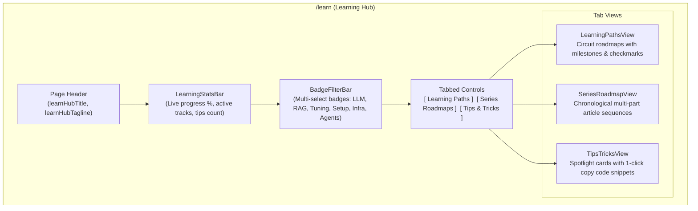

# Learning Hub, Roadmaps & Engineering Tips — Design Specification

**Date:** 2026-10-19  
**Status:** Approved  
**Project:** Epoch — Cybernetic AI Research & Engineering Publication  

---

## 1. Overview & Objectives

Epoch is evolving from an article publication into a **day-to-day engineering workbench and learning destination** for AI researchers and practitioners. This specification designs the **Learning Hub (`/learn`)**, integrating structured step-by-step Learning Paths, multi-part Series roadmaps, a copyable Tips & Tricks vault, and multi-badge filtering with persistent local progress tracking.

### Core Objectives
1. **Structured Learning Roadmaps (`content/paths/`)**: Curated engineering tracks (e.g. *LLM Inference & Production Systems*, *Autonomous Agent Architectures*, *Advanced RAG*) with sequential milestones, estimated completion hours, and visual circuit progress indicators.
2. **Persistent Progress Tracking**: User milestone completions are stored in `localStorage` (`epoch_learning_progress`), driving an animated live progress ticker and celebratory milestone checkmarks.
3. **Bite-Sized Tips & Tricks Vault (`content/tips/`)**: Rapidly actionable engineering tips with 1-click code copy buttons, syntax-highlighted snippets, and audio micro-click feedback.
4. **Multi-Badge Interactive Filtering**: Instant client-side filtering across both discipline and tool badges (`LLM`, `RAG`, `Tuning`, `Setup`, `Infra`, `Agents`), displaying real-time matching counts.
5. **Series Roadmaps View**: Cohesive exploration of multi-part technical deep-dives with chapter progression cards.
6. **Command Palette Integration**: Tips and learning paths indexed into `MiniSearch` for direct access via `Ctrl+K`.

---

## 2. Architecture & Component Decomposition



### Component Inventory & Responsibilities
- `src/app/learn/page.tsx`: Top-level page route statically generated with Next.js SSG, orchestrating tab switching and filter state.
- `src/components/learn/learning-stats-bar.tsx`: Real-time monospace HUD bar tracking completed milestones, progress percentage, and active tracks.
- `src/components/learn/badge-filter-bar.tsx`: Multi-select badge buttons with live count indicators, active lime styling, and keyboard navigation.
- `src/components/learn/learning-path-card.tsx`: Visual circuit roadmap card featuring progress bar, timeline nodes, article links, and persistent checkmarks.
- `src/components/learn/series-roadmap-view.tsx`: Chronological card sequence for multi-part series deep dives.
- `src/components/learn/tip-card.tsx`: SpotlightCard container with badge tags, technical summary, monospace code box, and 1-click copy button.
- `src/lib/learn/progress-storage.ts`: Type-safe helper for reading and writing milestone completions to `localStorage`.

---

## 3. Data Collections & Content Schemas

We add two new type-safe collections in `velite.config.ts`:

### A. `paths` (`content/paths/**/*.mdx`)
```typescript
export const paths = defineCollection({
  name: "Path",
  pattern: "paths/**/*.mdx",
  schema: s.object({
    id: s.string(),
    title: s.string().max(120),
    summary: s.string().max(300),
    badge: s.string(), // "LLM" | "RAG" | "Tuning" | "Setup" | "Infra" | "Agents"
    level: s.enum(["Beginner", "Intermediate", "Advanced"]),
    estimatedHours: s.number().positive(),
    order: s.number().int().default(1),
    steps: s.array(
      s.object({
        id: s.string(),
        title: s.string().max(140),
        description: s.string(),
        postSlug: s.string().optional(),
        externalUrl: s.string().optional(),
        type: s.enum(["article", "code", "benchmark"]).default("article"),
      })
    ),
    body: s.mdx(),
  }),
});
```

### B. `tips` (`content/tips/**/*.mdx`)
```typescript
export const tips = defineCollection({
  name: "Tip",
  pattern: "tips/**/*.mdx",
  schema: s.object({
    id: s.string(),
    title: s.string().max(120),
    summary: s.string().max(300),
    badges: s.array(s.string()), // e.g. ["LLM", "Setup", "Infra"]
    codeSnippet: s.string(),
    copyLabel: s.string().default("Copy snippet"),
    order: s.number().int().default(1),
    body: s.mdx(),
  }),
});
```

---

## 4. UI & Interaction Design

### A. Multi-Badge Filtering
- Supported badges: `All`, `LLM`, `RAG`, `Tuning`, `Setup`, `Infra`, `Agents`.
- Behavior:
  - Clicking `All` resets active badges to empty set.
  - Clicking a badge toggles its membership in `activeBadges: Set<string>`.
  - When `activeBadges` is non-empty, items are included if their badges overlap with `activeBadges`.
  - Count indicators next to badge labels dynamically display matching items in the current active tab.

### B. Progress Storage (`src/lib/learn/progress-storage.ts`)
- Key: `epoch_learning_progress` in `localStorage`.
- Data format: `Record<string, boolean>` mapping `${pathId}:${stepId}` to boolean.
- API:
  - `getCompletedSteps(): Set<string>`
  - `toggleStepCompletion(stepKey: string): boolean`
  - `isStepCompleted(stepKey: string): boolean`
  - `getPathProgress(pathId: string, totalSteps: number): { completed: number; total: number; percentage: number }`
- Gracefully degrades to memory storage if `localStorage` is unavailable.

### C. 1-Click Code Copy
- `TipCard` features a dedicated copy button.
- When clicked:
  - Copies `codeSnippet` via `navigator.clipboard.writeText`.
  - Swaps icon from `Copy` to `Check` and label to `siteConfig.ui.copiedSnippetLabel` ("Copied!").
  - Triggers audio feedback: `useOptionalSound().playSound("tick")`.
  - Automatically reverts to `Copy` icon after 2000ms.

---

## 5. Configuration & Labels

All copy is defined in `config/schemas/site.ts` and `config/site.ts`:
- `navLearnLabel`: `z.string().default("Learn")`
- `learnHubTitle`: `z.string().default("Learning Hub")`
- `learnHubTagline`: `z.string().default("Structured paths, deep-dive series, and production tips for modern AI systems engineering.")`
- `tabPathsLabel`: `z.string().default("Learning paths")`
- `tabSeriesLabel`: `z.string().default("Series roadmaps")`
- `tabTipsLabel`: `z.string().default("Tips & tricks")`
- `copySnippetLabel`: `z.string().default("Copy snippet")`
- `copiedSnippetLabel`: `z.string().default("Copied!")`
- `progressCompletedLabel`: `z.string().default("Completed")`
- `milestonesLabel`: `z.string().default("Milestones")`
- `filterAllLabel`: `z.string().default("All")`

---

## 6. Accessibility & Reduced Motion

- **Accessibility**:
  - Semantic `<nav>`, `<main>`, `<section>`, and `<ol>` lists for roadmap steps.
  - Checkboxes use `<button role="checkbox" aria-checked={isCompleted}>`.
  - Tab controls use `role="tablist"`, `role="tab"`, and `role="tabpanel"`.
  - Visible focus indicators styled with `focus-visible:ring-2 focus-visible:ring-lime`.
- **Reduced Motion**:
  - Checkmarks toggle instantly without animation bursts.
  - 3D card tilt on `SpotlightCard` disabled.
  - Progress bar transitions are instant.

---

## 7. Testing & Verification

- `tests/content-learning-schema.test.ts`: Validates `paths` and `tips` Velite schemas.
- `tests/progress-storage.test.ts`: Validates `localStorage` reading, writing, toggling, and fallback.
- `tests/badge-filter.test.tsx`: Validates multi-badge selection, counts, and filtering logic.
- `tests/learning-hub.test.tsx`: Validates page rendering, tab switching, path checklists, tip copy actions, and header navigation link.
- Full suite verification: `npm run typecheck`, `npm run lint`, `npm run test`, `npm run build`.
